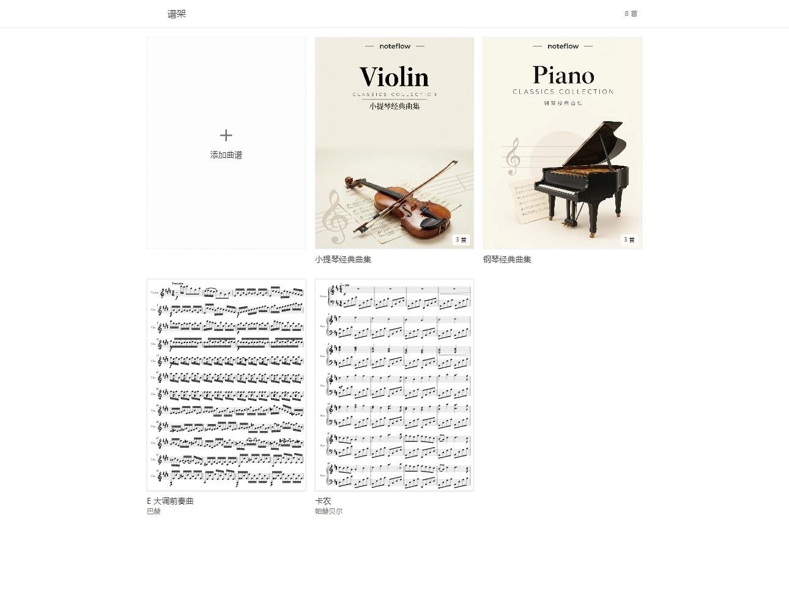
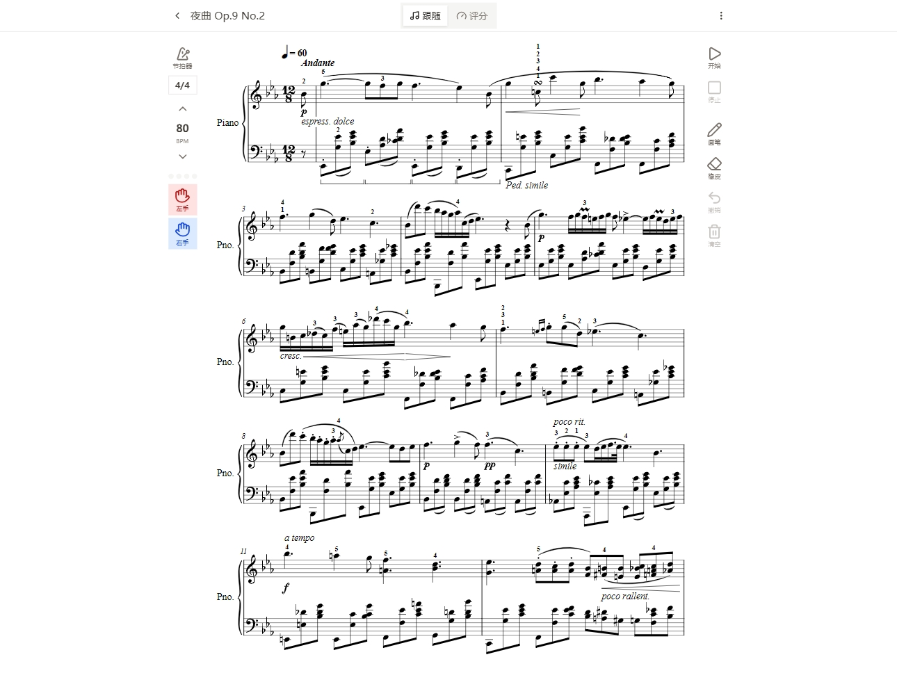

# NoteFlow

NoteFlow是一个曲谱、曲谱集管理的工具，并且所有数据都在本地处理与储存。[在线体验](https://noteflow.zhoujump.com)  

你可以对你的曲谱进行手写标注、也可以使用节拍器辅助演奏，甚至可以帮你翻谱。  
> ps:高速演奏与提琴的识别率堪忧  

你可以上传你的图片、PDF，并将其转换为电子版的MusicXML数据并导出以便在其它应用中使用。
